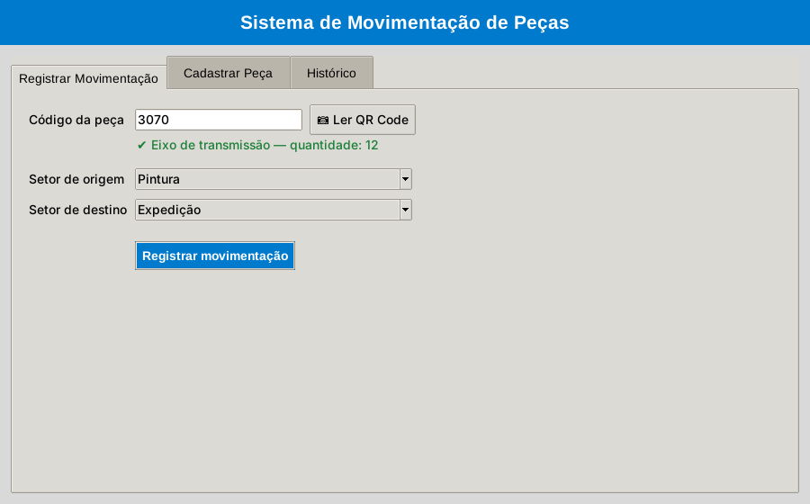
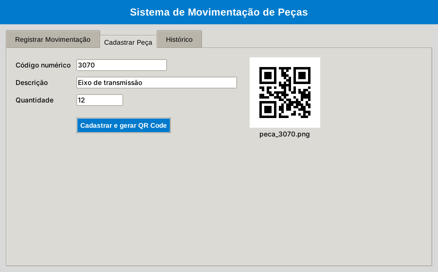
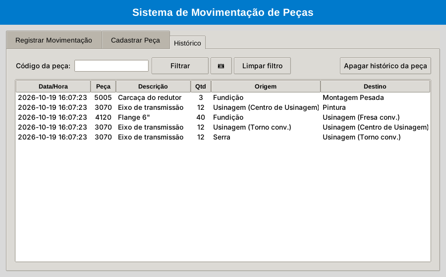

# 🏭 Sistema de Movimentação de Peças — ProjetoERP Fatec

Mini ERP de chão de fábrica para **rastrear peças entre os setores de produção usando QR Code**. Cada peça cadastrada recebe uma etiqueta com QR Code; quando ela muda de setor (da Serra para a Usinagem, depois para a Pintura…), basta ler o código com a câmera e registrar a movimentação. O histórico mostra por onde cada peça passou.

Projeto desenvolvido para a **Fatec**.



## ✨ Funcionalidades

- **Cadastro de peças** com código, descrição e quantidade, gerando automaticamente o **QR Code** da peça (`qrcodes_pecas/`)
- **Leitura do QR Code pela webcam** (OpenCV) para identificar a peça
- **Registro de movimentação** entre os 11 setores da fábrica (Ferbal, Serra, Fundição, Usinagem, Montagem, Pintura, Expedição…)
- **Histórico** completo ou filtrado por peça
- Exclusão do histórico de uma peça, com confirmação
- Validações: código numérico, quantidade positiva, peça existente, origem diferente do destino
- Duas formas de uso: **interface gráfica** (Tkinter) ou **menu no terminal**

| Cadastro com QR Code | Histórico |
|---|---|
|  |  |

## 🛠️ Tecnologias


- **Python 3** com **Tkinter** (interface gráfica)
- **SQLite** (banco de dados local)
- **OpenCV** (leitura do QR Code pela câmera)
- **qrcode + Pillow** (geração das etiquetas)

## 🚀 Como rodar

Pré-requisitos: Python 3.10+ e uma webcam (para ler os QR Codes).

```bash
git clone https://github.com/oliversoriano/ProjetoERP-Fatec.git
cd ProjetoERP-Fatec
pip install -r requirements.txt
```

Interface gráfica:

```bash
python interface_tkinter.py
```

Ou pelo terminal:

```bash
python projetoerp.py
```

O banco `movimentacao_pecas.db` e a pasta `qrcodes_pecas/` são criados automaticamente na primeira execução.

## 🗂️ Banco de dados

```
pecas                          movimentacoes
─────────────────              ──────────────────────
codigo (PK)       ◄──────────  codigo_peca (FK)
descricao                      id (PK)
quantidade                     origem
data_cadastro                  destino
caminho_qrcode                 data_hora
```

## 📁 Estrutura

```
ProjetoERP-Fatec/
├── projetoerp.py         # Regras de negócio + menu de terminal
├── interface_tkinter.py  # Interface gráfica
├── requirements.txt      # Dependências
└── docs/                 # Capturas de tela do README
```

## 👤 Autor

**[Oliver Soriano](https://github.com/oliversoriano)**
